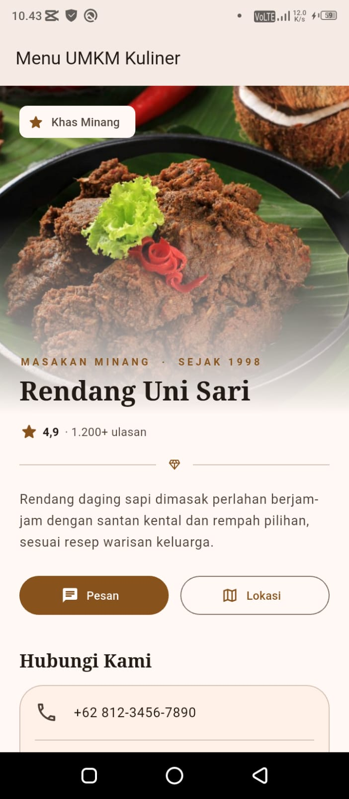
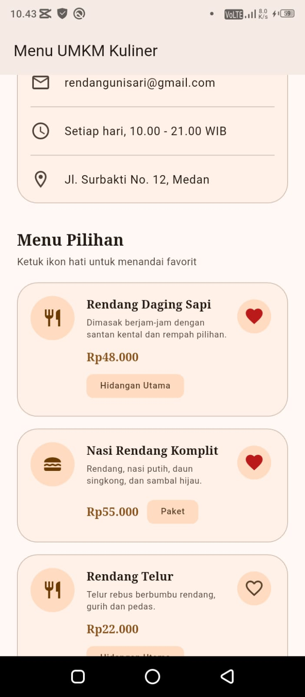
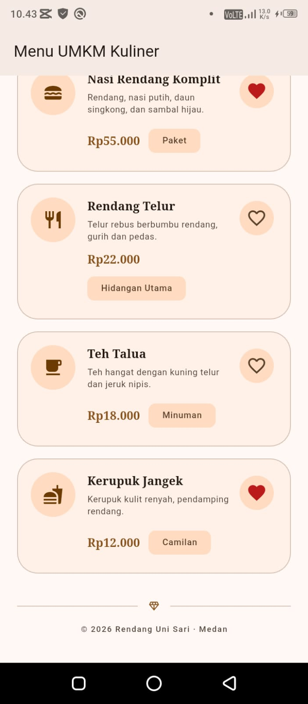
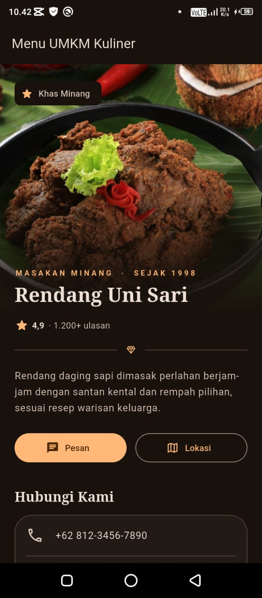
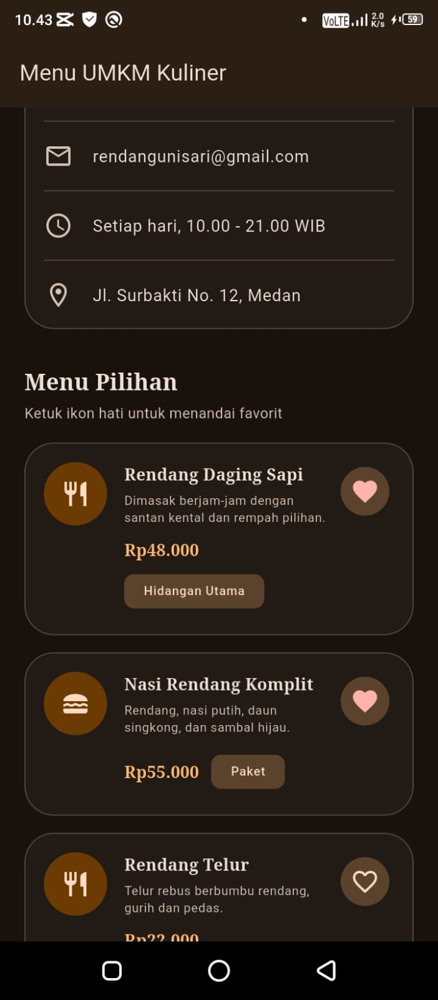
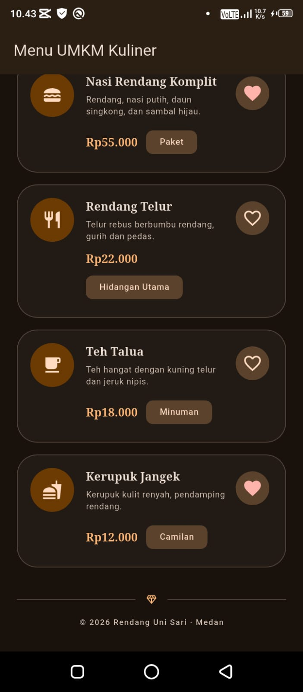
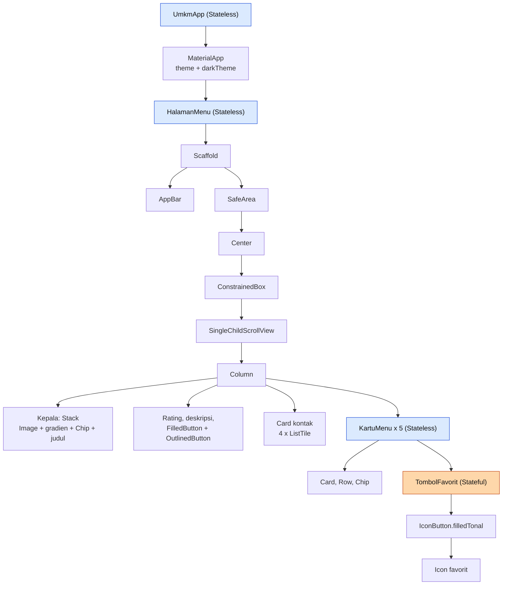

# Tugas Rutin 5 - Halaman Menu UMKM Kuliner Medan

**Nama:** Siti Haliza Zamili
**NIM:** 4241250019
**Kelas:** PSIK 24D

## Deskripsi
Aplikasi Flutter satu halaman untuk UMKM kuliner khas Medan, "Rendang Uni Sari".
Halaman memuat gambar utama, identitas usaha, informasi kontak, dan daftar menu. Setiap menu
memiliki tombol hati untuk menandai favorit yang mengubah ikon dan menampilkan SnackBar.
Aplikasi memakai Material Design 3 dengan tema terang dan gelap yang diturunkan dari satu
seed color (`ColorScheme.fromSeed`).

## Struktur Proyek
```
lib/main.dart            -> UmkmApp, HalamanMenu, KartuMenu, TombolFavorit
test/widget_test.dart    -> widget test tombol favorit
assets/images/header.jpg -> gambar utama
```

## Cara Menjalankan
```
flutter pub get
flutter run
```
Pengujian dan pemeriksaan kode:
```
flutter test
flutter analyze
```

## Tangkapan Layar

### Mode Terang
<table>
  <tr>
    <td></td>
    <td></td>
    <td></td>
  </tr>
</table>

### Mode Gelap
<table>
  <tr>
    <td></td>
    <td></td>
    <td></td>
  </tr>
</table>

## Diagram Widget Tree
Diagram disederhanakan. Biru menandai widget **Stateless**, oranye menandai widget **Stateful**.



| Widget | Jenis | Alasan |
|---|---|---|
| `UmkmApp` | Stateless | Tema tetap, tidak ada data yang berubah |
| `HalamanMenu` | Stateless | Hanya menyusun tampilan, kontak dan menu bersifat tetap |
| `KartuMenu` | Stateless | Hanya menampilkan nama, harga, kategori, dan deskripsi dari parameter |
| `TombolFavorit` | Stateful | Menyimpan status `_favorit` yang berubah saat ditekan |

## Penjelasan
Widget tree adalah susunan widget yang saya tulis di dalam method `build()`, mulai dari `UmkmApp` sampai `Icon` di dalam `TombolFavorit`. Widget tree hanya berisi konfigurasi, yaitu gambaran apa yang ingin ditampilkan, dan dibuat ulang setiap `build()` dipanggil. Element tree adalah pasangan dari setiap widget pada posisinya. Element bertahan lama, menyimpan objek `State` (misalnya status `_favorit`), dan menjadi `BuildContext`. Render tree berisi objek seperti `RenderFlex` dan `RenderParagraph` yang menghitung ukuran dan posisi lalu menggambar ke layar. Saat tombol hati ditekan, `setState` menandai element `TombolFavorit` sebagai kotor, `build()` dipanggil lagi, lalu Flutter membandingkan widget baru dengan yang lama sehingga element dan render object lama dipakai ulang dan hanya ikonnya yang berubah.

`UmkmApp`, `HalamanMenu`, dan `KartuMenu` saya buat Stateless karena tampilannya hanya bergantung pada parameter dan tidak punya data yang berubah. Contohnya, kontak dan daftar menu bersifat tetap, sedangkan status favorit hanya perlu diingat oleh tombolnya sendiri. `TombolFavorit` saya buat Stateful karena menyimpan `_favorit` yang berubah saat ditekan. Bagian Stateful sengaja dibuat sekecil mungkin, sehingga menekan hati tidak membangun ulang seluruh halaman. Dengan begitu perubahan data hanya memicu pembaruan pada bagian yang memang berubah, sedangkan widget lain tetap dipakai ulang oleh Flutter.

## Pernyataan Penggunaan AI
Saya menggunakan Claude (Anthropic) selama mengerjakan tugas ini.

**Dibantu AI:**
- Penjelasan materi Pertemuan 5 (modul dan slide).
- Kode `lib/main.dart` dan `test/widget_test.dart`, termasuk rancangan tampilan bertema rendang.
- Diagram widget tree dan kerangka README.
- Langkah Git dan penyelesaian kendala (isi `pubspec.yaml`, pemasangan ke HP, konflik Git).
- Draf bagian Penjelasan (saya baca, pahami, dan sesuaikan).

**Saya kerjakan sendiri:**
- Menentukan konsep usaha dan menyiapkan foto rendang.
- Menyesuaikan teks pada aplikasi (judul AppBar, email, dan alamat).
- Menjalankan aplikasi di Chrome dan di HP Infinix, serta mengambil tangkapan layar mode terang dan gelap.
- Menjalankan `flutter test`, `flutter analyze`, dan `dart format`.
- Membuat repository GitHub, commit, dan push.